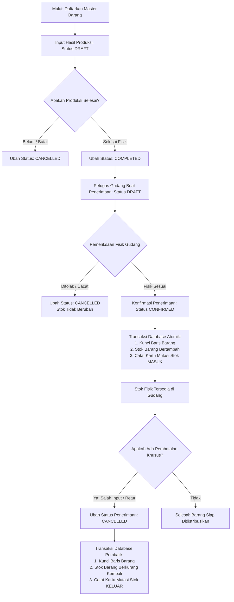

# Alur Bisnis Sistem Hasil Produksi dan Gudang

Dokumen ini menjelaskan alur operasional dari mulai pendaftaran barang, proses pencatatan hasil produksi pabrik, serah terima ke gudang, hingga mutasi penambahan dan pembatalan stok.

---

## 1. Diagram Alur Utama (Business Workflow)

---

## 2. Penjelasan Langkah-demi-Langkah

### Tahap 1: Pendaftaran Master Barang
1. Administrator mendaftarkan katalog barang dengan atribut:
   - `kode_barang` (unik, misal `BRG-001`)
   - `nama_barang` (misal `Pipa PVC AW 1/2 Inch`)
   - `satuan` (misal `batang`)
2. Stok awal yang dicatat adalah **0.00**.
3. Stok tidak boleh diubah secara manual melalui endpoint bebas. Satu-satunya jalan legal untuk menambah stok adalah melalui konfirmasi penerimaan gudang.

---

### Tahap 2: Pembuatan Hasil Produksi Pabrik
1. Divisi produksi membuat dokumen hasil pengerjaan mesin (`POST /api/produksi`).
2. Satu dokumen produksi (header) dapat memuat beberapa detail barang yang diproduksi sekaligus.
3. Sistem memvalidasi:
   - Semua barang yang dipilih harus dalam status aktif (`is_active = 1`).
   - Kuantitas produksi harus lebih besar dari 0 (`jumlah > 0`).
   - Tidak ada item barang duplikat di satu dokumen produksi.
4. Dokumen produksi yang baru dibuat berstatus **`draft`**.
5. Pada tahap ini, **stok di gudang belum bertambah** karena barang masih berada di area mesin pabrik dan belum diserahkan ke bagian gudang.

---

### Tahap 3: Penyelesaian Hasil Produksi
1. Ketika proses pencetakan/perakitan fisik selesai, operator memperbarui status produksi menjadi **`completed`** (`PATCH /api/produksi/:id/status`).
2. Setelah berstatus `completed`, kuantitas dan rincian barang pada dokumen produksi tersebut dikunci agar tidak dapat diubah-ubah lagi.
3. Status `completed` menjadi prasyarat mutlak sebelum divisi gudang dapat membuat dokumen penerimaan barang.

---

### Tahap 4: Serah Terima & Pembuatan Dokumen Penerimaan Gudang
1. Petugas gudang membuat tanda terima barang (`POST /api/penerimaan`) dengan merujuk pada `hasil_produksi_id`.
2. Sistem memeriksa:
   - Apakah hasil produksi berstatus `completed`? Jika masih `draft` atau `cancelled`, permohonan penerimaan langsung **ditolak**.
   - Berapa kuantitas kumulatif yang sudah pernah diterima untuk produksi ini? Sistem menjamin jumlah yang diterima tidak melebihi jumlah yang diproduksi.
3. Dokumen penerimaan dibuat dengan status awal **`draft`**.
4. Pada status `draft`, barang fisik masih dalam proses pengecekan hitungan di pintu penerimaan (*loading dock*), sehingga **angka stok gudang belum bertambah**.

---

### Tahap 5: Konfirmasi Penerimaan (Stok Gudang Bertambah)
1. Setelah jumlah fisik dihitung dan diverifikasi sesuai, kepala gudang mengonfirmasi penerimaan (`PATCH /api/penerimaan/:id/status` dengan status `confirmed`).
2. Operasi ini dieksekusi dalam satu **Transaksi Database ACID**:
   - Sistem mengunci baris data barang terkait (`SELECT ... FOR UPDATE`) untuk mencegah konflik konkurensi jika ada request bersamaan.
   - Angka stok pada tabel `barang` ditambah sesuai jumlah yang diterima (`stok_sesudah = stok_sebelum + jumlah_diterima`).
   - Sistem mencatat baris baru pada tabel `mutasi_stok` (tipe: `MASUK`, referensi: `PENERIMAAN`).
   - Status penerimaan berubah menjadi `confirmed`.
   - Perubahan dikomit ke database.
3. **Idempotensi:** Jika ada request konfirmasi ulang terhadap transaksi yang sudah `confirmed`, sistem menolak permintaan tersebut untuk mencegah penambahan stok ganda.

---

### Tahap 6: Pembatalan Penerimaan (*Cancellation & Reversal*)
1. Jika terjadi kesalahan input kuantitas atau barang ditolak kembali ke pabrik, transaksi penerimaan dapat dibatalkan (`PATCH /api/penerimaan/:id/status` dengan status `cancelled`).
2. Penanganan cerdas berdasarkan status sebelumnya:
   - **Jika dibatalkan dari status `draft`:**  
     Karena draft belum pernah menambah stok gudang, sistem cukup mengubah status menjadi `cancelled` tanpa memodifikasi stok atau tabel mutasi.
   - **Jika dibatalkan dari status `confirmed`:**  
     Sistem menjalankan transaksi pembalik:
     - Mengunci baris barang terkait.
     - Mengurangi kembali stok barang di master barang sejumlah barang yang dibatalkan.
     - Mencatat entri pembalik di `mutasi_stok` dengan tipe `KELUAR` dan referensi `PEMBATALAN_PENERIMAAN`.
     - Mengubah status penerimaan menjadi `cancelled`.
3. Dokumen yang sudah berstatus `cancelled` bersifat final dan tidak dapat diaktifkan kembali.

---

## 3. Matriks Transisi Status

### Status Hasil Produksi (`hasil_produksi`)
| Status Awal | Status Tujuan | Diizinkan? | Dampak Stok | Catatan |
| :--- | :--- | :---: | :---: | :--- |
| `draft` | `completed` | Ya | Tidak ada | Produksi fisik telah rampung. Siap diserahkan ke gudang. |
| `draft` | `cancelled` | Ya | Tidak ada | Produksi dibatalkan sebelum selesai. |
| `completed` | `draft` | **Tidak** | Tidak ada | Dokumen selesai tidak boleh diturunkan kembali ke draft. |
| `completed` | `cancelled` | Ya (Bersyarat) | Tidak ada | Hanya diizinkan jika belum pernah ada transaksi penerimaan gudang. |
| `cancelled` | *(status apa pun)* | **Tidak** | Tidak ada | Status final, tidak dapat diubah kembali. |

---

### Status Penerimaan Gudang (`penerimaan`)
| Status Awal | Status Tujuan | Diizinkan? | Dampak Stok | Catatan |
| :--- | :--- | :---: | :---: | :--- |
| `draft` | `confirmed` | Ya | **Bertambah (+)** | Stok fisik gudang resmi bertambah. Mutasi `MASUK` dicatat. |
| `draft` | `cancelled` | Ya | Tidak ada | Draft penerimaan dibatalkan sebelum verifikasi fisik selesai. |
| `confirmed` | `cancelled` | Ya | **Berkurang (-)** | Transaksi pembalik atomik: stok ditarik kembali, mutasi `KELUAR` dicatat. |
| `confirmed` | `draft` | **Tidak** | Tidak ada | Transaksi yang sudah masuk buku gudang tidak boleh kembali ke draft. |
| `cancelled` | *(status apa pun)* | **Tidak** | Tidak ada | Status final, tidak dapat diubah kembali. |
