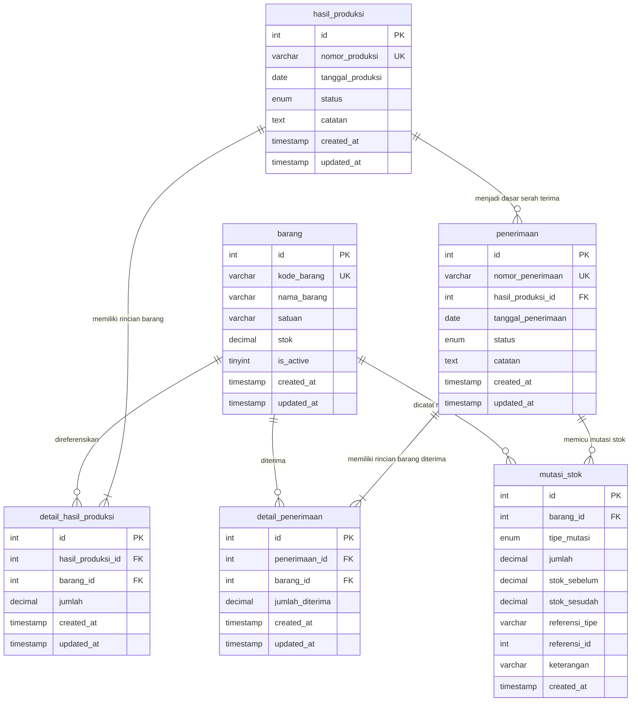

# Dokumentasi Database: Sistem Hasil Produksi dan Gudang

Dokumen ini menjelaskan rancangan skema database MySQL untuk sistem pencatatan hasil produksi pabrik dan penerimaan barang di gudang.

---

## 1. Konsep & Filosofi Desain

1. **Integritas Relasional (ACID & Foreign Keys)**  
   Semua tabel menggunakan engine **InnoDB** yang mendukung foreign key constraints dan transaksi database (ACID). Hal ini menjamin bahwa tidak ada data transaksi yang menggantung (*orphaned rows*) tanpa induk yang jelas.

2. **Presisi Finansial & Kuantitas (`DECIMAL`)**  
   Kolom kuantitas menggunakan tipe `DECIMAL(12, 2)` dan bukan `FLOAT` atau `DOUBLE`. Hal ini penting dalam manufaktur dan pergudangan untuk menghindari *floating-point rounding errors* (kesalahan pembulatan koma desimal).

3. **Soft Deactivation untuk Master Barang**  
   Master barang tidak dihapus secara fisik (`DELETE`) dari database jika sudah tidak diproduksi lagi. Kolom `is_active` digunakan untuk menandai status aktif (`1`) atau nonaktif (`0`). Dengan aturan `ON DELETE RESTRICT`, histori produksi dan gudang di masa lalu tetap terjaga keasliannya dan tidak rusak.

4. **Kebenaran Tunggal Stok (*Single Source of Truth*) & Audit Trail**  
   Stok barang dihitung dan dikelola secara mutlak oleh backend melalui transaksi penerimaan resmi. Setiap perubahan stok dicatat dalam tabel `mutasi_stok` (kartu stok) lengkap dengan kuantitas sebelum, kuantitas sesudah, dan referensi transaksi pemicunya.

---

## 2. Diagram Hubungan Antar Tabel (Entity Relationship Diagram)

---

## 3. Rincian Struktur Tabel

### A. Tabel `barang` (Master Katalog Barang)
Menyimpan informasi identitas barang dan saldo stok fisik terkini di gudang.

| Nama Kolom | Tipe Data | Keterangan |
| :--- | :--- | :--- |
| `id` | `INT AUTO_INCREMENT` | **Primary Key** |
| `kode_barang` | `VARCHAR(50)` | **Unique Index**, kode resmi produk (misal: `BRG-001`) |
| `nama_barang` | `VARCHAR(255)` | Nama deskriptif barang |
| `satuan` | `VARCHAR(50)` | Satuan barang (contoh: `pcs`, `batang`, `box`, `kg`) |
| `stok` | `DECIMAL(12, 2)` | Jumlah stok gudang saat ini (Default: `0.00`) |
| `is_active` | `TINYINT(1)` | Status aktif: `1` = Aktif, `0` = Nonaktif |
| `created_at` | `TIMESTAMP` | Waktu pertama kali didaftarkan |
| `updated_at` | `TIMESTAMP` | Waktu terakhir data diubah |

---

### B. Tabel `hasil_produksi` (Header Transaksi Produksi)
Mencatat satu rangkaian pengerjaan produksi pada tanggal tertentu.

| Nama Kolom | Tipe Data | Keterangan |
| :--- | :--- | :--- |
| `id` | `INT AUTO_INCREMENT` | **Primary Key** |
| `nomor_produksi` | `VARCHAR(50)` | **Unique Index**, nomor surat perintah produksi (misal: `PRD-20261024-0001`) |
| `tanggal_produksi` | `DATE` | Tanggal pengerjaan produksi |
| `status` | `ENUM('draft', 'completed', 'cancelled')` | Status proses produksi (Default: `draft`) |
| `catatan` | `TEXT` | Catatan opsional (misal: nomor shift, nomor mesin) |
| `created_at` | `TIMESTAMP` | Waktu pembuatan data |
| `updated_at` | `TIMESTAMP` | Waktu pembaruan status data |

---

### C. Tabel `detail_hasil_produksi` (Detail Barang Produksi)
Menghubungkan satu transaksi produksi dengan banyak barang yang diproduksi (*one-to-many*).

| Nama Kolom | Tipe Data | Keterangan |
| :--- | :--- | :--- |
| `id` | `INT AUTO_INCREMENT` | **Primary Key** |
| `hasil_produksi_id` | `INT` | **Foreign Key** ke `hasil_produksi(id)` |
| `barang_id` | `INT` | **Foreign Key** ke `barang(id)` |
| `jumlah` | `DECIMAL(12, 2)` | Kuantitas yang diproduksi (Constraint: `jumlah > 0`) |
| `created_at` | `TIMESTAMP` | Waktu pencatatan |
| `updated_at` | `TIMESTAMP` | Waktu pembaruan |

*Catatan: Terdapat constraint `UNIQUE KEY (hasil_produksi_id, barang_id)` untuk mencegah item barang yang sama tercatat lebih dari satu kali dalam satu dokumen produksi.*

---

### D. Tabel `penerimaan` (Header Penerimaan Gudang)
Mencatat serah terima fisik dari divisi produksi ke divisi gudang.

| Nama Kolom | Tipe Data | Keterangan |
| :--- | :--- | :--- |
| `id` | `INT AUTO_INCREMENT` | **Primary Key** |
| `nomor_penerimaan` | `VARCHAR(50)` | **Unique Index**, nomor tanda terima gudang (misal: `RCV-20261024-0001`) |
| `hasil_produksi_id` | `INT` | **Foreign Key** ke `hasil_produksi(id)` |
| `tanggal_penerimaan` | `DATE` | Tanggal barang fisik masuk ke gudang |
| `status` | `ENUM('draft', 'confirmed', 'cancelled')` | Status penerimaan (Default: `draft`) |
| `catatan` | `TEXT` | Catatan penerimaan petugas gudang |
| `created_at` | `TIMESTAMP` | Waktu dokumen dibuat |
| `updated_at` | `TIMESTAMP` | Waktu konfirmasi atau pembatalan |

---

### E. Tabel `detail_penerimaan` (Detail Barang Diterima)
Mencatat rincian barang dan jumlah aktual yang diterima di gudang.

| Nama Kolom | Tipe Data | Keterangan |
| :--- | :--- | :--- |
| `id` | `INT AUTO_INCREMENT` | **Primary Key** |
| `penerimaan_id` | `INT` | **Foreign Key** ke `penerimaan(id)` |
| `barang_id` | `INT` | **Foreign Key** ke `barang(id)` |
| `jumlah_diterima` | `DECIMAL(12, 2)` | Jumlah kuantitas aktual diterima (Constraint: `jumlah_diterima > 0`) |
| `created_at` | `TIMESTAMP` | Waktu pencatatan |
| `updated_at` | `TIMESTAMP` | Waktu pembaruan |

---

### F. Tabel `mutasi_stok` (Kartu Stok / Audit Trail)
Mencatat jejak kronologis setiap pertambahan atau pengurangan kuantitas stok barang.

| Nama Kolom | Tipe Data | Keterangan |
| :--- | :--- | :--- |
| `id` | `INT AUTO_INCREMENT` | **Primary Key** |
| `barang_id` | `INT` | **Foreign Key** ke `barang(id)` |
| `tipe_mutasi` | `ENUM('MASUK', 'KELUAR')` | Arah aliran barang |
| `jumlah` | `DECIMAL(12, 2)` | Jumlah kuantitas perpindahan |
| `stok_sebelum` | `DECIMAL(12, 2)` | Saldo stok sebelum mutasi |
| `stok_sesudah` | `DECIMAL(12, 2)` | Saldo stok setelah mutasi |
| `referensi_tipe` | `VARCHAR(50)` | Asal transaksi: `PENERIMAAN` atau `PEMBATALAN_PENERIMAAN` |
| `referensi_id` | `INT` | ID transaksi pemicu (`penerimaan_id`) |
| `keterangan` | `VARCHAR(255)` | Keterangan audit |
| `created_at` | `TIMESTAMP` | Waktu terjadinya mutasi |

---

## 4. Alasan Pemilihan Desain Relasional

1. **Mencegah Stok Gaib / Data Tidak Sinkron:**  
   Dengan adanya tabel `mutasi_stok`, angka stok di tabel `barang` selalu dapat dibuktikan dengan menjumlahkan seluruh mutasi masuk dikurangi mutasi keluar.
2. **Kepatuhan Audit:**  
   Setiap pengurangan stok akibat pembatalan penerimaan tercatat sebagai mutasi `KELUAR` dengan tipe referensi `PEMBATALAN_PENERIMAAN`. Tidak ada riwayat yang dihapus diam-diam.
3. **Pemisahan Tanggung Jawab:**  
   Divisi produksi bertugas mencatat hasil buatannya (`hasil_produksi`). Divisi gudang bertugas memverifikasi fisik barang yang masuk (`penerimaan`). Stok gudang tidak bertambah sebelum petugas gudang mengonfirmasi penerimaan secara sah.
